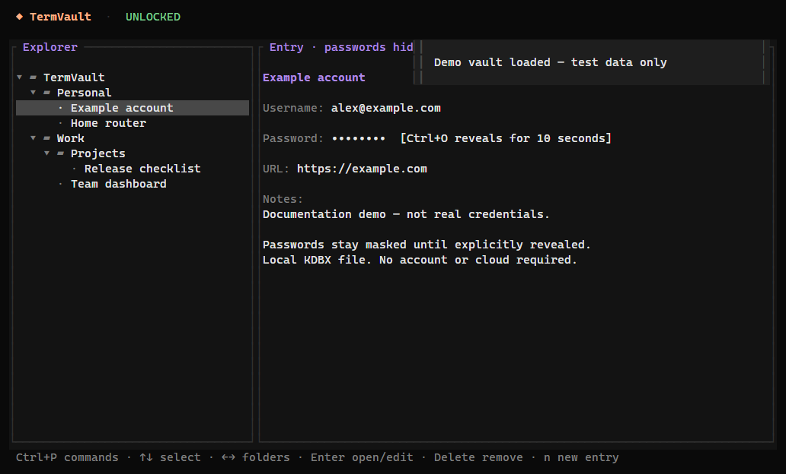
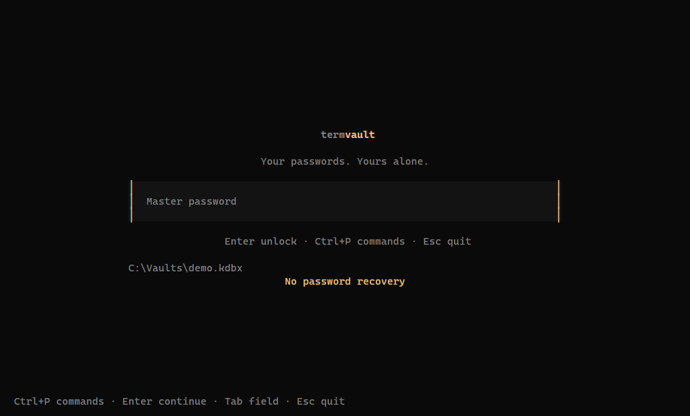
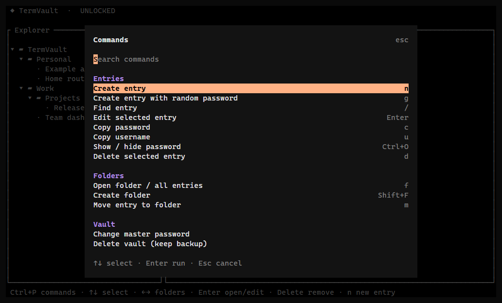

# TermVault

[](https://github.com/Andrey89711/TermVault/actions/workflows/ci.yml)
[CI/CD and draft releases](docs/RELEASING.md)

**Experimental local password vault in your terminal.** Rust, Ratatui, dark panels,
peach accents, purple headings and ordinary KeePass KDBX4 storage. Command: **`tvault`**.

> **Not audited. Do not use this MVP as the only copy of real credentials.**
> The `keepass` Rust library describes KDBX writing as experimental. Keep independent,
> tested backups. This is not a claim of production security or full KeePass compatibility.

## Features

- Create a vault, unlock with a masked master passphrase, and lock manually or on inactivity.
- Entry list, title filtering, details, creation, editing, and confirmed deletion.
- Title, username, password, URL, and multiline notes. Passwords hidden by default.
- Cryptographically random 24-character passwords from the OS random source.
- Explicit password/username copy with best-effort conditional clipboard clearing.
- Encrypted backups before every mutation, atomic file replacement, external-change checks.
- No server, account, cloud, automatic URL opening, or arbitrary command execution.
- Optional private Windows browser extension: click-to-fill with local unlock and explicit approval.
  See [browser setup](browser/README.md). Experimental; test credentials first.
  Store submission preparation: [publishing checklist](docs/STORE-PUBLISHING.ru.md).

TermVault is independent of OpenTerminal and TerminalNote. It can run in a compatible
terminal such as Windows Terminal or OpenTerminal. It does not modify shell profiles.

## Screenshots

Actual TUI renders use disposable vaults and fictional records, never personal
credentials. Passwords remain masked in documentation screenshots.







## Build and run

The current release is [v0.1.2](https://github.com/Andrey89711/TermVault/releases/tag/v0.1.2):
download `termvault-0.1.2-windows-x86_64.zip` and verify its SHA-256 against `SHA256SUMS.txt`.
Extract the complete ZIP and run **`setup.cmd`**, not `setup.ps1` directly.
The launcher applies `ExecutionPolicy Bypass` only to its child PowerShell process;
it does not change your saved execution policy. Organization-managed policies may
still block unsigned scripts. Packages remain unsigned; verify their source first.
Run `setup.cmd` / `setup.ps1` from a release ZIP for guided per-user installation.
Uninstall through Windows Settings → Apps → TermVault, or run `uninstall.cmd`
in the installed directory. Vaults, backups and unrelated files are always retained.
Setup adds the installed directory to the current user's PATH (without changing
the system PATH) and saves the selected default vault. Open a new terminal and run
`tvault`; no EXE path is needed. An explicit `tvault C:\Vaults\other.kdbx` overrides it.
From a clone, `setup.ps1 -Build` uses the installed Rust toolchain; without Rust,
the wizard points to releases instead of silently installing developer tools.
See [CI/CD and releasing](docs/RELEASING.md) and the
[Windows ZIP quickstart](browser/QUICKSTART.ru.md). Release drafts require manual approval.

Requires stable Rust **1.89 or newer**. On Windows use the MSVC toolchain, Visual Studio
C++ Build Tools, and the Windows SDK. No administrator permissions are needed.

```powershell
git clone https://github.com/Andrey89711/TermVault.git
cd TermVault
cargo build --release --locked

# Explicitly create a new vault, then choose and confirm a master passphrase in the UI
.\target\release\tvault.exe --create

# Reopen it
.\target\release\tvault.exe

# Or use an explicit path (relative paths are relative to the current directory)
.\target\release\tvault.exe --create C:\Vaults\demo.kdbx
.\target\release\tvault.exe C:\Vaults\demo.kdbx
```

`--create` never overwrites an existing file. Parent folders are created only after
you submit a valid, matching new master passphrase. Without `--create`, missing files
are errors. Without setup defaults, the vault lives in the OS local-data directory,
under `TermVault/vault.kdbx` (usually `%LOCALAPPDATA%\TermVault\vault.kdbx` on Windows).
Setup saves the chosen absolute vault path in `TermVault/settings.json` in that same
local-data directory. This file contains no password or encryption key. An explicit
CLI vault path always overrides the saved default.

### Language and settings

The TUI defaults to **English**. Open **Ctrl+P → Language** and choose **English**
or **Russian**; the choice persists across restarts. CLI output and documentation
remain English. Language changes preserve the existing default vault setting.
Entry contents, folder names, filenames and operating-system diagnostics retain
their original text. Setup/repair also preserves the saved language preference.

`TermVault/settings.json` in the OS local-data directory stores non-secret settings:

```json
{
  "vault": "C:\\Vaults\\personal.kdbx",
  "language": "en"
}
```

The existing path field is **`vault`**, not `vault_path`. Use `en` or `ru` for
`language`; omitting it selects English. Prefer the language menu and setup wizard
to manual edits. Neither setting contains a master passphrase or encryption key.

For isolated test sessions, the hidden `--settings-file ABSOLUTE_PATH` option
selects a disposable settings file explicitly. The optional
`TERMVAULT_LOCAL_DATA_DIR` environment variable changes the runtime local-data
root, but PTY tests use the explicit argument to avoid ConPTY environment-forwarding
differences. Neither mechanism supplies a master password or bypasses vault unlock.

Install the command into your Cargo bin directory, if desired:

```powershell
cargo install --path . --locked
tvault
```

The TUI requires a terminal on stdin/stdout. Master passwords are not accepted via
arguments, environment variables, pipes, or files. There is no plaintext export command.

## Keys

| Key | Action |
| --- | --- |
| ↑ / ↓ | Select folder or entry |
| ← / → | Collapse / expand folders; move to parent / first child |
| `/` | Filter entry titles; Enter applies, Esc clears |
| `n` | New entry |
| `g` | New entry with a generated 24-character password |
| `f` | Open the folder picker (including All entries and `/`, the root) |
| Shift+F | Create a folder inside the current folder (root in All entries) |
| `m` | Move the selected entry to a folder |
| Enter | Expand/collapse folder or edit entry |
| Ctrl+P | Open/close the command palette; type a command name in Russian or English |
| Ctrl+P → Language | Choose and save English or Russian UI language |
| Ctrl+O | Show/hide the selected/form password (automatically hides after 10 seconds) |
| `p` | Reveal selected password for 10 seconds |
| `c` / `u` | Copy password / username |
| Delete / `d` | Ask to delete the selected folder or entry; `d` confirms, Esc cancels |
| Ctrl+L | Lock vault |
| `q` / Ctrl+Q | Quit (`q` only in the entry browser) |
| Tab / Shift+Tab | Next / previous form field |
| Ctrl+S | Save entry immediately |
| Ctrl+G | Generate a new password in the entry form |
| Ctrl+U | Clear the current input |
| ← / →, Home / End, Backspace / Delete | Edit input |
| Enter in Notes | Insert a newline |
| Esc in form | Return, confirming if unsaved |

Paste using your terminal's paste action (often Ctrl+Shift+V). Bracketed paste is
supported; multiline paste is accepted only in Notes. Ctrl+S/L/Q/G/P/O also recognize
the corresponding standard Russian keyboard characters. Single-letter commands
and confirmations currently use EN. The form does not have undo/redo.

The palette supports ↑/↓ (or Tab/Shift+Tab), Enter or a click on a command to select,
and Esc to cancel. Clicked commands are mapped directly to the displayed action.
Only actions available in the current context are listed. Lock, exit and returning
from an edited entry retain the unsaved-changes confirmation. Deleting a selected
entry still opens a separate confirmation; selecting the command does not delete it.
Opening the palette hides any revealed password, and inactivity auto-lock closes it.
No password is entered in the palette, no command history is saved and no shell
commands are executed. The palette is unavailable in browser approval/confirmation
dialogs and while a sensitive confirmation is open.

### Folders

Folders are native KDBX groups inside the same encrypted file, not filesystem
directories. When folders exist, the left pane is an expandable Explorer tree:
folders first, then records, with indentation, arrows and a gray selection highlight.
Click a folder or press Enter to expand/collapse; use ↑/↓ to select and ←/→ to
navigate parents/children. Click a record to select it, then Enter to edit. The
TermVault node represents the root and cannot be deleted. New records are saved
under the selected folder (or alongside the selected record). Editing an existing
record preserves its folder. Use `m` or **Move entry to folder** to move it.

The `f` picker remains as a quick jump to a folder; All entries returns to the tree.
Title search spans all folders, including collapsed ones, and displays a flat result
list. Browser approval also stays a flat, origin-filtered list. Mouse wheel navigation
is supported in the Explorer; use your terminal's selection override (often Shift)
to select terminal text while mouse capture is enabled.

Shift+F or **Create folder** creates a folder under the selected folder. Nested
folders are supported; names must be unique within their parent, 1–128 bytes, with
no slash or control characters. The vault limit is 100 groups including the root.
Folder changes use verified encrypted saves and retain backups. To delete a folder,
select it in the tree, then press Delete or select **Delete selected folder** in Ctrl+P. Confirmation shows
the full folder path and total record/subfolder counts. Press `d` to remove the
folder and its entire subtree, or Esc to cancel (Enter does not confirm). Even empty
folders require confirmation. Root and All entries cannot be deleted. Encrypted
backups retain the deleted contents; this is not secure erasure. Folder rename is
not yet offered. Read-only vaults allow browsing only; browser approval
searches matching entries across all folders and never modifies their structure.

### Sensitive commands and update checks

- **Change master passphrase** is available from the entry list for writable TermVault
  vaults. Current, new and confirmation inputs are masked in a separate form; Ctrl+O
  never reveals them. The current passphrase is rechecked, and the encrypted candidate
  is reopened and verified before replacement. Existing backups, including the one
  retained for this operation, still require the **old** passphrase; they are not rekeyed.
- **Delete vault (keep backup)** requires the current passphrase, the exact filename
  including extension, and a final `d` confirmation after the full target path is visible.
  Authorization expires after 60 seconds and is bound to the original ciphertext revision.
  The active file is moved to a random encrypted backup in the same directory. Other
  backups and unrelated files are not removed. **This is not secure erasure.** The
  session is locked afterward; Enter/Esc closes the result screen. External file changes
  cancel the operation. Trusted parent storage and no concurrent editors remain required:
  the final check/move cannot eliminate all filesystem races, but the moved ciphertext
  is preserved rather than destroyed.
- Finish/save/discard an entry draft before changing its master passphrase or deleting
  the vault; those actions are not offered while editing. Esc and inactivity auto-lock
  discard sensitive input buffers. Neither action is available for foreign read-only
  vaults or from the browser bridge.
- **Check updates** works only after explicit consent to a request to GitHub's public
  release API. GitHub sees the client IP and `TermVault/<version>` User-Agent, not vault
  paths, credentials or current sites. HTTPS redirects are disabled, response size is
  bounded and the request times out after 10 seconds. There are no startup/background
  scheduled checks and **no downloading, execution or installation** of an update.
  The result is available through the palette without interrupting an entry draft.
  This is informational release metadata over HTTPS, not signed update authorization.

## Locking and unsaved changes

Inactivity auto-lock defaults to **120 seconds**. Override with `--lock-after 15..3600`.
Manual lock/quit/back asks to save, discard, or cancel when an entry draft has changes.
**Inactivity auto-lock discards unsaved drafts without waiting for a confirmation**,
so save important edits before leaving the terminal. There is no draft recovery.

There is no master-password recovery or backdoor. Keyfiles, TOTP, passkeys,
attachments are not implemented.
Browser filling is an optional read-only Windows integration, not automatic background autofill.

## Storage and compatibility

New vaults use the standard KDBX4 format via [`keepass` 0.17.0](https://github.com/sseemayer/keepass-rs):

- AES-256 outer encryption, the KDBX format's integrity protection, ChaCha20 protected fields.
- Argon2id v1.3: **64 MiB, 3 iterations, parallelism 1** in production builds.
- No compression. All five entry fields use protected KDBX values, not only the password.
- Maximum encrypted file: 8 MiB; maximum 2,000 entries and 100 groups when opening.
- Bounded preflight validation rejects excessive/malformed KDF parameters before decryption.

This MVP deliberately opens only the uncompressed AES-256 / Argon2id KDBX4 subset,
with KDF memory 8–128 MiB, iterations 1–10, and parallelism 1–8. Other KeePass files
may be rejected; public custom header data is also unsupported. Files whose generator
is not `TermVault/0.1` open **read-only**;
editing foreign databases is restricted to avoid damaging unsupported features.
Another application may change that generator, making the vault read-only here.
Do not import your main password database merely to try this MVP.

Candidate saves are encrypted and reopened before replacement. If the source file
changed since unlock, saving fails and the draft stays in memory. Do not use two
editors concurrently: the final comparison/rename still has an unavoidable race.

Each successful mutation retains the previous encrypted file as
`<name>.kdbx.backup-<random>.kdbx` in the same directory. Backups are **not automatically
deleted** and retain old passwords/deleted records. You can open a backup by its path.
If replacement fails after the backup was written, that valid backup may remain too.
Temporary files contain ciphertext only. Keep the entire folder on trusted storage;
Windows access inherits the parent directory's ACLs. There is no additional DPAPI binding.

## Security limitations

- This app and its dependencies have not been independently audited as a product.
- Explicit reveal exposes a password to terminal buffers, screen capture, and shoulder surfing.
- Decrypted data exists in memory while unlocked. App-owned inputs use zeroizing buffers
  and the library protects secret values, but parser/renderer/OS copies, swap, crash dumps,
  and terminal buffers are **not guaranteed to be wiped**. There is no memory locking.
- Auto-lock drops the unlocked session; it is not protection against malware, an administrator,
  or another process running with the same user's privileges.
- Clipboard clearing is best effort and occurs after 20 seconds, on lock, or on clean exit,
  only if the current text still equals what TermVault copied. Clipboard races, history,
  synchronization, and other software can retain copies. Windows history/cloud exclusion
  hints are requested, not guaranteed. Force termination prevents scheduled clearing.
- No credentials are intentionally logged. Panic messages omit payloads. Debuggers and OS
  dumps are outside that guarantee. Do not pass secrets in shell arguments or filenames.
- Open only trusted vault files. Size/KDF bounds reduce risks but are not a parser sandbox
  or a hard wall-clock timeout. A strong master passphrase remains essential.

## Development

```powershell
cargo fmt --all -- --check
cargo clippy --all-targets --locked -- -D warnings
cargo test --all-targets --locked
cargo build --release --locked
```

Unit tests use temporary vaults and dummy passwords. Test-only KDF settings are reduced
to 8 MiB/1 iteration for speed; the regular binary, including debug, uses production settings.
Do not commit vaults, backups, keyfiles, or real credentials. They are ignored by default.

The real-PTY test launches the regular binary (Windows ConPTY on Windows), creates a
temporary vault, edits/saves a dummy record, locks, rejects a wrong password and reopens
the vault. It uses a terminal screen parser for rendering assertions and checks that
masked dummy passwords were never emitted. It does not read or alter your clipboard.

## License

[MIT](LICENSE), copyright (c) 2026 Andrey89711. Third-party dependency licenses remain applicable.
